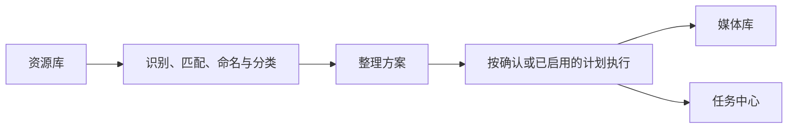

# MediaFlow

**面向自托管媒体库的影视文件整理工具。**

从资源库读取文件名、目录和 NFO，可用 TMDB 补全电影与剧集信息。按规则生成整理方案，确认后把媒体文件及相关附件整理到目标媒体库。

[快速开始](#-快速开始) · [配置说明](docs/configuration.md) · [部署指南](docs/deployment.md) · [文档索引](docs/README.md)

## ✨ 功能

- **管理两类媒体库**。资源库存放待整理文件，媒体库存放整理结果。支持本地、SMB、OpenList 和 S3 兼容存储。
- **自定义整理规则**。配置识别、元数据匹配、命名和分类。按存储能力执行移动、复制、硬链接或软链接。
- **先复核再执行**。在资源库选择文件或文件夹，查看目标、操作和冲突。确认后由 Worker 执行。
- **定时整理**。从自动化页面配置来源、时间和范围，也可手动运行一次。
- **逐项查看和恢复**。在任务中心查看各文件的结果，并处理识别、元数据、分类或冲突问题。



## 🚀 快速开始

### 使用 Docker Compose

需要 Git、Python 3、Docker 和 Compose。默认部署启动 API、Worker、Scheduler 和 Notification Worker。

1. 下载源码，生成启动配置。

   ```bash
   git clone https://github.com/kentinya/mediaflow.git
   cd mediaflow
   python3 scripts/make_deployment_config.py --output config/mediaflow.json
   cp deploy/mediaflow.env.example .env.mediaflow
   ```

2. 按容器默认 UID/GID 设置环境文件权限并启动。该文件只保存可选的服务凭据，不再保存 Web 登录令牌。

   ```bash
   sudo chown 10001:10001 .env.mediaflow
   sudo chmod 0440 .env.mediaflow
   docker compose up -d --build
   docker compose ps
   ```

3. 在主机上领取一次性设置码，打开 <http://127.0.0.1:8080/> 创建首位管理员。

   ```bash
   docker compose exec -T api mediaflow accounts issue-setup-code
   ```

   创建成功后进入「系统设置」初始化为空配置，再按需添加存储、资源库、媒体库和整理规则。日常使用账号密码登录。忘记密码时，在主机执行 `docker compose exec -T api mediaflow accounts issue-reset-code --username '<登录名>'`。

默认以管理模式启动。本地媒体目录通过 Compose 覆盖文件显式挂载。挂载、日志、备份和网络设置见[部署指南](docs/deployment.md)。

### 使用 Python 源码

本地开发需要 Python 3.11–3.13 和 Node.js 22.13+（22.x）。在仓库根目录执行。

```bash
python3 -m venv .venv
.venv/bin/pip install -e '.[tmdb,openlist]'
npm --prefix web ci
npm --prefix web run build
python3 scripts/make_deployment_config.py \
  --output config/mediaflow.json \
  --database-path "$PWD/.mediaflow/mediaflow.sqlite3"
export MEDIAFLOW_CONFIG="$PWD/config/mediaflow.json"
.venv/bin/mediaflow api serve --host 127.0.0.1 --port 8787
```

打开 <http://127.0.0.1:8787/>，在另一个终端用同一个 `MEDIAFLOW_CONFIG` 执行 `.venv/bin/mediaflow accounts issue-setup-code`，再在网页创建首位管理员。需要执行任务时用同一个配置启动 `.venv/bin/mediaflow worker run`。定时整理另需启动 Scheduler。

## ⚙️ 常用配置

| 配置 | 用途 |
| --- | --- |
| `config/mediaflow.json` | 指定 SQLite 路径等启动信息，不保存账号或登录令牌。 |
| `.env.mediaflow` | Compose 使用的环境文件，仅存放可选的服务凭据。 |
| `TMDB_ACCESS_TOKEN` | 使用 TMDB 探索或元数据匹配时设置。 |
| Web「系统设置」 | 初始化、检查和直接应用配置。运行服务读取已发布快照。 |
| Web「存储」「文件」「媒体库」「整理规则」 | 配置输入、目标和整理方式。首次整理时可先用少量文件复核方案。 |

Web 从 `/` 登录，脚本使用分权限令牌访问 `/api/*`。`GET /health` 可查看进程和首次设置状态。[脚本令牌](docs/deployment.md#script-api-tokens) · [部署边界](docs/deployment.md#boundary)

## 📚 文档与开发

| 文档 | 内容 |
| --- | --- |
| [配置说明](docs/configuration.md) | 凭据、直接发布、存储、库和规则。 |
| [部署指南](docs/deployment.md) | Compose、媒体挂载、服务状态、备份和恢复。 |
| [用户操作](docs/product-experience.md) · [任务中心](docs/task-center-page-spec.md) | 文件管理、整理确认、逐项结果和恢复。 |
| [架构](docs/architecture.md) · [需求](docs/requirements.md) | 模块职责、数据边界和稳定需求。 |
| [构建与发布](docs/release.md) · [验收记录](docs/progress.md) | 构建门禁、支持边界和大版本验收。 |
| [开发约束](AGENTS.md) · [开发流程](docs/development-workflow.md) | 角色、测试和审查。 |

`main` 是当前开发分支，版本定义在 [pyproject.toml](pyproject.toml)。
